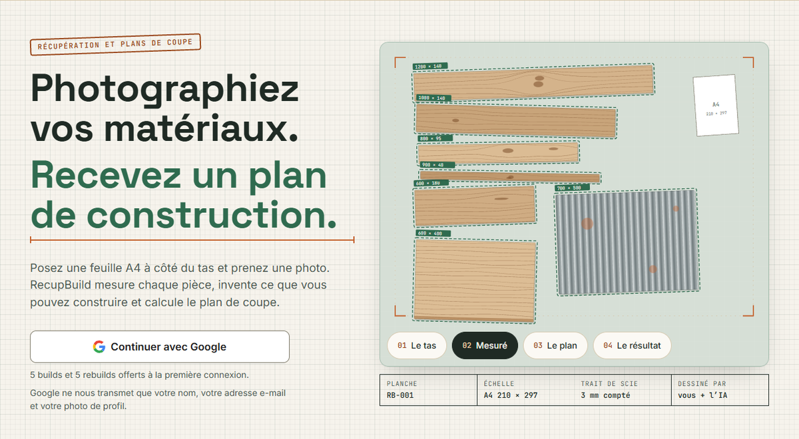
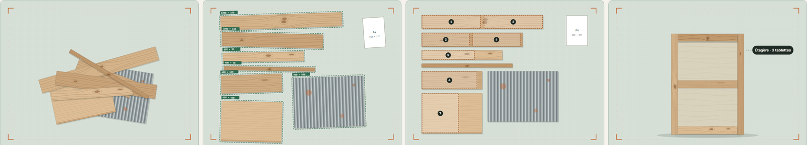
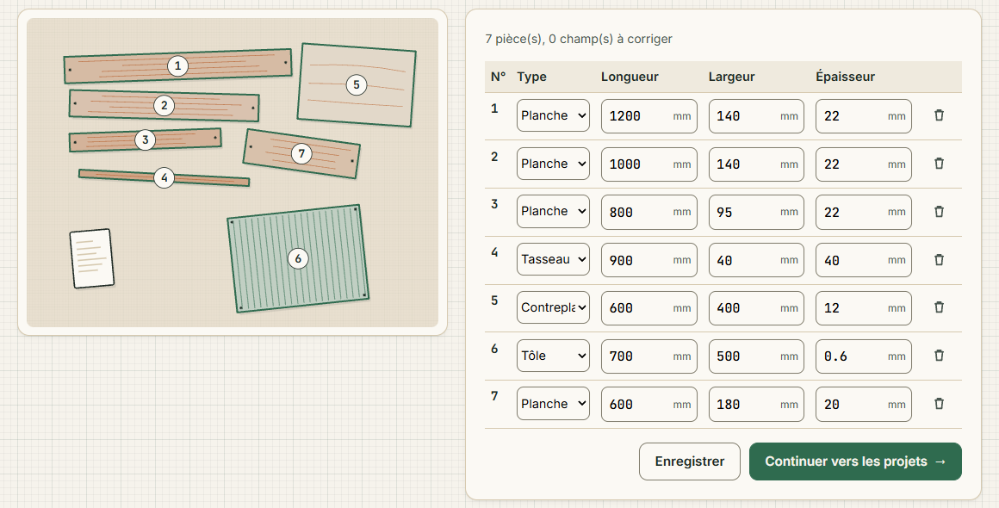
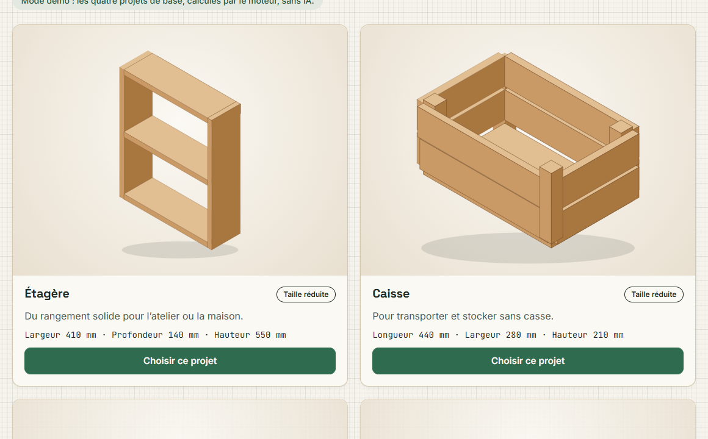
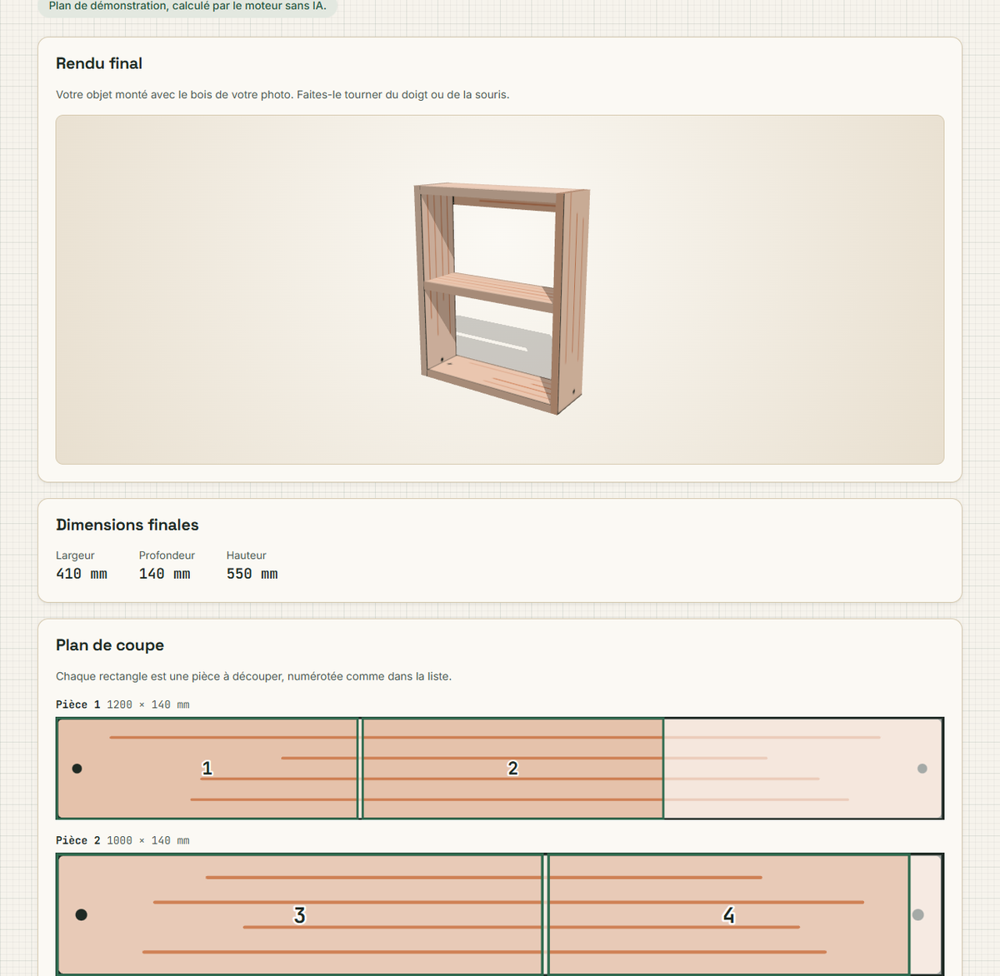
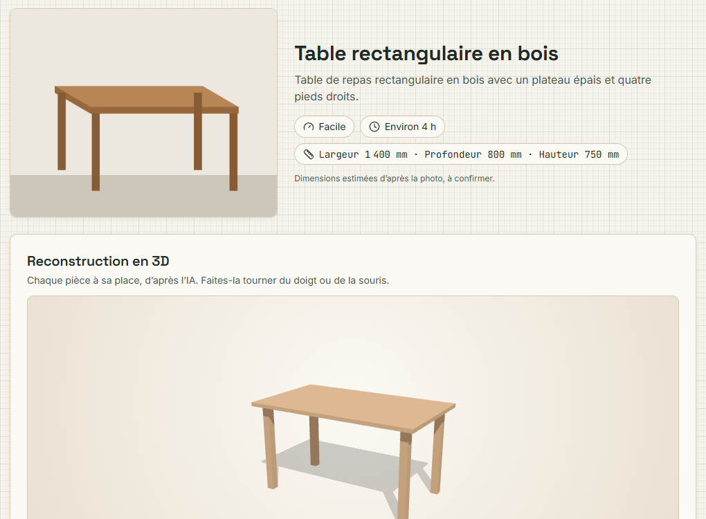
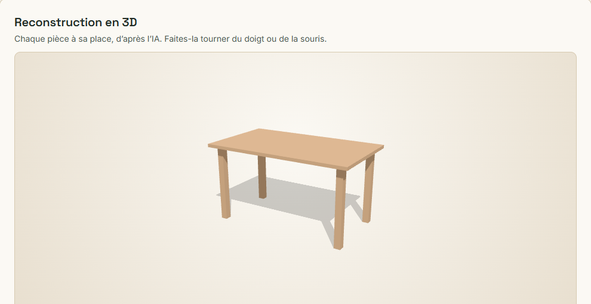
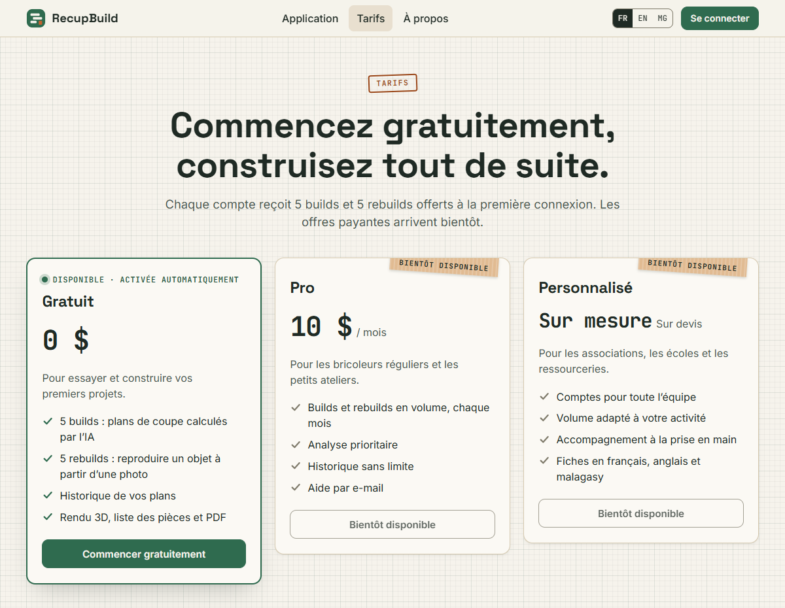
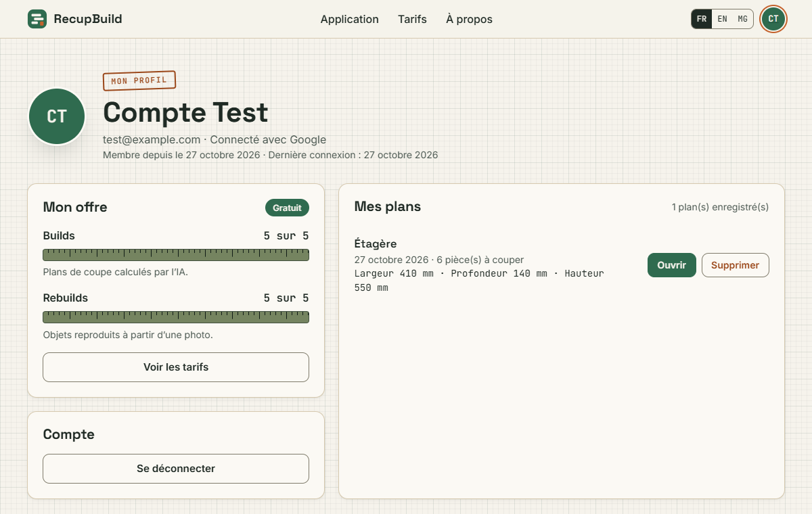
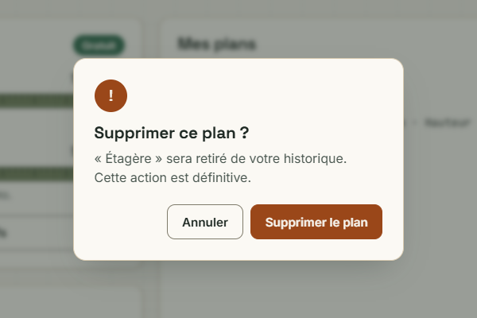

<div align="center">


# RecupBuild

**Photograph your reclaimed materials. Get a building plan.**

An A4 sheet next to the pile gives the scale: the AI measures every plank,
invents four projects sized to your wood, an engine places every cut,
and you leave with the cutting plan, the 3D render and the assembly steps.


### ▶ Watch the 3-minute pitch

[](https://youtu.be/sO_UkvMmugU)

</div>



---

## Contents

- [Pitch video (YouTube)](https://youtu.be/sO_UkvMmugU)
- [What RecupBuild does](#what-recupbuild-does)
- [The pages](#the-pages)
- [The free plan](#the-free-plan)
- [Run it locally](#run-it-locally)
- [Code layout (MVC)](#code-layout-mvc)
- [Routes](#routes)
- [Configuration](#configuration-env)
- [Deploying on a VPS](#deploying-on-a-vps)
- [Tests](#tests)
- [Technical notes](#technical-notes)

---

## What RecupBuild does

### From pile to plan



| Step | What happens |
| --- | --- |
| **1. Scan** | One photo of the pile with an A4 sheet: the vision model finds every piece and measures it in millimetres; the thickness is estimated. |
| **2. Inventory** | You check the table of pieces and fix a dimension if needed. |
| **3. Projects** | The AI **invents 4 useful projects** for *this* wood (shelf, planter, stool…); the engine checks that every part can really be cut. |
| **4. Calculation** | The cutting engine places every part on your planks, saw kerf included, and shrinks the dimensions when something doesn't fit. |
| **5. Result** | A 3D render with the texture of **your** wood, a numbered cutting plan, the parts list, the assembly steps and a PDF. |

<p align="center">
  
  
</p>

<p align="center">
  
</p>

> **The AI proposes, the engine decides.** No figure on screen is a free guess:
> every plan has been checked part by part by `Services/Solver.php`.

### The reverse build

Photograph a finished object (a table, a stool, a bookcase): RecupBuild tells you which
parts to cut, with which tools and in what order, and rebuilds it in 3D.

<p align="center">
  
  
</p>

---

## The pages

The whole site is rendered by **PHP** (`src/Views`), with the same look everywhere:
graph paper, forest green, copper. A small library-free JavaScript file
(`js/pages.js`) adds what needs a script: the home page animation, the waiting
screen while the AI works, the confirmation dialogs, the photo preview.
The 3D result uses three.js, bundled in `vendor/three`. Every page still works
without JavaScript.

| Page | Address | Content |
| --- | --- | --- |
| Home | `/` | the pile becoming a plan (4 animated moments), the steps, the projects, the reverse build |
| Build | `/scan` → `/inventory` → `/projects` → `/plans/{id}` | photo, inventory to check, 4 projects, result |
| Rebuild an object | `/rebuild` → `/rebuilds/{id}` | reverse build of a photographed object |
| History | `/history` | plans and rebuilt objects, to reopen or delete |
| Pricing | `/pricing` | Free (available), Pro and Custom (coming soon) |
| My profile | `/profile` | account, credits left, plans, sign out |
| About | `/about` | the story of the project, born at the **Meta hackathon** |

<p align="center">
  
  
</p>

Deleting a plan and signing out go through a **confirmation dialog**
(native `<dialog>`: keyboard, Escape, focus returned to the button).

<p align="center">
  
</p>

**Examples**: on `/scan`, both examples use a real photo of offcuts next to an A4 sheet.
"Instant demo" shows the scan the model made of it once (`src/Services/demo-scan.json`) and
the four built-in projects planned by the engine alone, **with no AI call and no credit used**;
the other example sends the same photo to the AI live. On `/rebuild`, the example is a real
photo of a solid wood table.

The pages speak **English** and **French** (`?lang=en|fr`, remembered in a cookie; **English by default**).
The Malagasy tab is hidden (commented out in `src/Views/layout.php`) until its translations are written.

---

## The free plan

| Plan | Price | Includes | Status |
| --- | --- | --- | --- |
| **Free** | $0 | 5 builds + 5 rebuilds, history, 3D render, PDF | **Available**, turned on automatically at first sign-in |
| **Pro** | $10 / month | builds and rebuilds in volume, priority analysis | Coming soon |
| **Custom** | on quote | associations, schools, reuse centres | Coming soon |

- a **build** = one successful cutting plan (`POST /api/plan`);
- a **rebuild** = one successful reverse build (`POST /api/reverse`);
- the scan and the project cards are **not** counted;
- a credit is spent **only on success**, and at zero the server refuses **before** calling
  the model (`402 {"detail":{"code":"quota_exhausted"}}`).

The counters live in the `users` table (`build_credits`, `rebuild_credits`); a single
`UPDATE … WHERE credits > 0` decrements them, so two simultaneous requests never spend
the same credit.

---

## Run it locally

```sh
cp .env.example .env.php           # put MODEL_API_KEY and the Google credentials in it
php -S localhost:8080
```

That's all: run it from the project folder. `php -S localhost:8080 index.php` works too, and is
the stricter of the two (it serves only the site's own files).

Nothing private can leak, even though PHP's built-in server serves the whole folder:

- the secrets are in **`.env.php`**, whose first line is `<?php exit; ?>`: requested, it prints nothing;
- the database and the photos live **outside the project**, in `../recupbuild-storage/`
  (or wherever `STORAGE_PATH` points);
- the views and the tests answer 404 when they are requested directly.

Then open **http://localhost:8080** (not `127.0.0.1`, or the Google redirect won't match).

| Address | Page |
| --- | --- |
| `http://localhost:8080` | the home page |
| `http://localhost:8080/scan` | the app (Google sign-in required) |
| `http://localhost:8080/pricing` | pricing |
| `http://localhost:8080/profile` | the profile (Google sign-in required) |
| `http://localhost:8080/api/health` | server status |

The SQLite database (`../recupbuild-storage/recupbuild.sqlite`) creates and migrates itself on first access.

---

## Code layout (MVC)

No framework, no Composer dependency: only the `curl`, `gd`, `exif`, `fileinfo`,
`pdo_sqlite`, `mbstring` and `json` extensions.

```
index.php            front controller: bootstrap, CORS, then the router
.env.php             the secrets (not in git; starts with <?php exit; ?>)
.htaccess            Apache: serves the site's files, everything else to index.php
css/ js/ fonts/      the pages' style, script and fonts
images/              logos and the author's photo
vendor/three/        three.js (MIT licence), for the 3D result
demo/ examples/      the demo photo and the examples to try (real photos)
src/
  routes.php         every route: method + path -> controller@action
  Core/              Router, Controller, View, Config, DotEnv, Http, Request, Session, Database, Upload, Cors
  Controllers/       Home, Workspace (scan -> projects), PlanPage, Rebuild, Profile, Pricing, Auth,
                     and the API: Health, Scan, Plan, History
  Models/            Users (accounts, credits), Plans, Rebuilds, Photos, Workspace (the journey in session),
                     Projects (project definitions)
  Services/          Vision (the model), Planner, Solver (cutting engine), Scan, Reverse, Image,
                     GoogleAuth, Assembly (3D layout), Drawing (SVG drawings), Demo
  Errors/            ScanError, VisionError, AuthError
  Views/             the layout and one view per page, their texts in lang/en.php and lang/fr.php
tests/               php tests/run.php
deploy/              nginx and Apache examples

../recupbuild-storage/   the SQLite database and the photos, outside the project (STORAGE_PATH)
```

- **Models**: the data (SQLite through PDO, photos in the storage folder) and their rules.
- **Views**: the pages (`Core\View` + `src/Views`) and the API's JSON answers (`Core\Http`).
- **Controllers**: one class per area; `member()` requires a session (otherwise Google),
  `checkForm()` checks the CSRF token, `user()` guards the API.
- **Services**: the actual work, with no HTTP and no database (the model, the engine, images, drawings).

Adding a page means one line in `src/routes.php`, one controller method and one view;
an `{id}` parameter reaches the action as an `int`.

---

## Routes

**Pages**

| Method | Route | Purpose | Session |
| --- | --- | --- | --- |
| `GET` | `/` · `/about` · `/pricing` | home, about, pricing | |
| `GET` / `POST` | `/scan` | photo of the pile (upload, AI example or demo) | ✓ |
| `GET` / `POST` | `/inventory` | inventory to check | ✓ |
| `GET` | `/projects` · `POST /projects/choose` | 4 projects, then the plan of the chosen one (1 build credit) | ✓ |
| `GET` | `/plans/{id}` · `/plans/{id}/photo` | the result and the original photo | ✓ |
| `GET` / `POST` | `/rebuild` · `GET /rebuilds/{id}` | reverse build (1 rebuild credit) | ✓ |
| `GET` | `/history` · `/profile` | history, profile | ✓ |
| `POST` | `/profile/plans/{id}/delete` · `/profile/rebuilds/{id}/delete` · `/profile/logout` | confirmed forms (CSRF token) | ✓ |
| `GET` | `/auth/google` · `/auth/google/callback` | server-side Google sign-in | |

**JSON API** (same engine, for other clients)

| Method | Route | Purpose |
| --- | --- | --- |
| `GET` | `/api/health` | key and model status (public) |
| `GET` | `/api/me` | the signed-in user, or 401 |
| `POST` | `/api/scan` · `/api/reverse` | photo (`file`) → measured pieces · object to rebuild |
| `POST` | `/api/projects` · `/api/plan` | invented projects · cutting plan |
| `GET` / `DELETE` | `/api/history` · `/api/history/{id}` | plan history |

API errors look like `{ "detail": { "code": "a4_not_detected" } }` with the right status
(401 not signed in, 402 no credits left, 413 too large, 415 format, 422 analysis, 502 model,
504 timeout). Any other address shows the "not found" page.

---

## Configuration (`.env.php`)

| Variable | Default | Purpose |
| --- | --- | --- |
| `MODEL_API_KEY` (or `MUSE_IMAGE_API_KEY`) | empty | Meta model key, required for the AI |
| `META_API_BASE` | `https://api.meta.ai/v1` | model endpoint |
| `VISION_MODEL` | `muse-spark-1.3` | model used |
| `GOOGLE_CLIENT_ID` / `GOOGLE_CLIENT_SECRET` | empty | Google sign-in (Google Cloud Console → Clients, "Web application") |
| `GOOGLE_REDIRECT_URI` | `http(s)://<host>/auth/google/callback` | declare it exactly under "Authorized redirect URIs" |
| `STORAGE_PATH` | `../recupbuild-storage` | folder of the database and the photos, outside the project |
| `DATABASE_PATH` | `<STORAGE_PATH>/recupbuild.sqlite` | SQLite file, if it must live elsewhere |
| `ALLOWED_ORIGINS` | `http://localhost:5173,...` | CORS, not needed when the site and the API share an origin |

`.env.php` holds the model key and the Google secret: it is ignored by git, prints nothing if
it is ever requested, is refused by `.htaccess` and `deploy/nginx.conf.example`, and must never be
published. (A plain `.env` is still read, for servers already set up to refuse it.)

---

## Deploying on a VPS

<details>
<summary><b>1. Upload the code</b></summary>

```sh
rsync -av --exclude .env.php --exclude .git/ backend-php/ user@vps:/var/www/recupbuild/backend-php/
ssh user@vps 'cd /var/www/recupbuild/backend-php && cp .env.example .env.php && nano .env.php'
```

</details>

<details>
<summary><b>2. Install PHP and its extensions</b></summary>

```sh
sudo apt install php-fpm php-gd php-curl php-xml php-mbstring php-sqlite3
```

In `/etc/php/8.3/fpm/php.ini` (and `cli/php.ini`):

```ini
upload_max_filesize = 12M
post_max_size = 14M
max_execution_time = 300
memory_limit = 256M
```

In `/etc/php/8.3/fpm/pool.d/www.conf`: `request_terminate_timeout = 300s`, then
`sudo systemctl restart php8.3-fpm`. Without this, the request is cut off at 30 s while
inventing the projects takes 45 to 110 s.

The storage folder, next to the project, must be writable by PHP-FPM:
`sudo mkdir -p /var/www/recupbuild/recupbuild-storage && sudo chown -R www-data: /var/www/recupbuild/recupbuild-storage`.

</details>

<details>
<summary><b>3. Serve the site (nginx or Apache)</b></summary>

**nginx**: copy `deploy/nginx.conf.example` into `/etc/nginx/sites-available/`
(domain and PHP version), then `sudo nginx -t && sudo systemctl reload nginx`.

**Apache**: copy `deploy/apache-vhost.conf.example`; `DocumentRoot` points to the
project folder, with `AllowOverride All` for its `.htaccess`.

</details>

<details>
<summary><b>4. HTTPS</b></summary>

```sh
sudo apt install certbot python3-certbot-nginx
sudo certbot --nginx -d recupbuild.example.com
```

Then declare `https://recupbuild.example.com` under the JavaScript origins and
`https://recupbuild.example.com/auth/google/callback` under the Google redirect URIs.

</details>

---

## Tests

```sh
php tests/run.php            # 80 checks: scan, cutting engine, invented projects, reverse build,
                             # Google sign-in, SQLite, history, credits, drawings, inventory, page texts
php tests/live_plan.php      # real call to the model: cards, plan and steps
```

---

## Technical notes

- **Safe AI output**: everything the model returns (projects, parts, 3D layouts) is bounded and
  validated again by `Models/Projects::sanitize` or `Services/Reverse::build` before it reaches the browser.
- **Google sign-in**: server-side *authorization code* flow, with `state` and `nonce`; the secret
  never leaves the server, the session is an `HttpOnly` / `SameSite=Lax` cookie.
- **Pages**: every text is escaped, forms carry a CSRF token, and a
  *Content-Security-Policy* only allows the site's own scripts and styles.
- **Images**: GD decoding (JPEG, PNG, WebP), EXIF rotation, longest edge at 1600 px, JPEG 85.
- **Latency**: a request holds a PHP *worker* during the model call; plan for
  `pm.max_children` ≥ 5 if several people use it at once.

---

<div align="center">


**RecupBuild** was born at the **Meta Global AI Developer Hackathon**: building with what you already have.

*Indicative plan: check every dimension on your pieces before cutting.*

</div>
